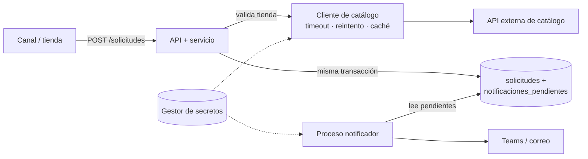

# 04 · Diseño de evolución: notificaciones y validación de tienda

Cómo evolucionaría el prototipo para **(a)** notificar las solicitudes de prioridad Alta por correo o Teams sin duplicar avisos y **(b)** validar la tienda contra una API externa de catálogo. No está implementado.

## Herramienta: código

Ambas son integraciones que deben comportarse de forma predecible ante fallos, así que las resuelvo en código, en el mismo repositorio y con la misma arquitectura por capas: la lógica queda versionada y probada, y la regla "un solo aviso por solicitud" la garantiza la base de datos. Descarté Power Automate como pieza central porque la lógica quedaría fuera del repositorio y sin pruebas; lo usaría solo si el negocio necesita editar el texto del aviso sin desplegar código.

## (a) Notificaciones sin duplicados

- Al registrar una solicitud Alta, en **la misma transacción** inserto una fila en `notificaciones_pendientes`. Si la transacción falla, no queda ni la solicitud ni el aviso.
- Una **restricción única** sobre (`solicitud_id`, `canal`) impide dos avisos para la misma solicitud.
- Un **proceso notificador** aparte envía y marca `enviada` solo tras un envío exitoso. Así el `POST` no depende de que Teams o el correo estén disponibles.
- **Reintentos** con espera exponencial (1, 2, 4, 8 y 16 minutos). Al quinto fallo queda `fallida` y genera una alerta: nada se pierde en silencio.

## (b) Validación de la tienda

- Un cliente de catálogo con **timeout de 2 s**, **un reintento** solo ante errores transitorios (timeout o 5xx) y **caché** de tiendas válidas por una hora.
- Si la tienda **no existe**, respondo `422`.
- Si el catálogo **no está disponible**, no detengo el registro: guardo la solicitud con `validacion_tienda = "pendiente"` y la revalido en segundo plano. Una novedad real no debe perderse porque un sistema externo esté caído.

## Credenciales y fallos

- La URL del webhook, la cuenta de correo y la llave del catálogo se leen de **variables de entorno alimentadas por el gestor de secretos** de la organización; nunca van en el repositorio.
- Registro cada fallo con el `id` de la solicitud y su motivo, sin datos sensibles.
